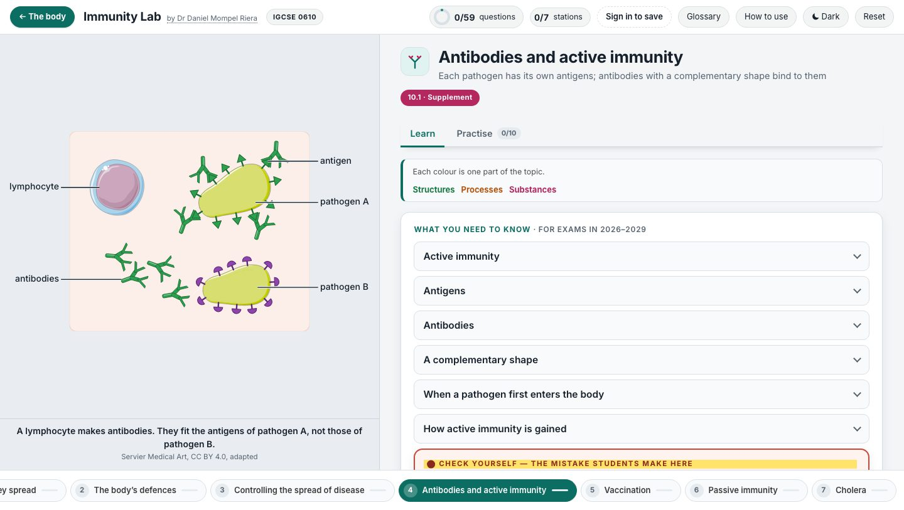

<div align="center">

<h1>🛡️ &nbsp;Immunity Lab</h1>

**Cambridge IGCSE Biology 0610 · Topic 10, Diseases and immunity**

[](https://nlcsbiology.com/immunity-lab/)


by **Dr Daniel Mompel Riera**

</div>



---

## What a student does

Each station has its own picture on the left and short cards on the right that open one at a time. Press a part of the
picture and its card opens; open a card and its part shows in the picture. The stations follow the T10 revision summary,
in its order and in its words. Then the questions say right or wrong, never the answer.

|  |  |
|---|---|
| 🦠 **7 stations** | pathogens and how they spread · the body’s defences · controlling the spread of disease · antibodies and active immunity · vaccination · passive immunity · cholera |
| ✍️ **59 questions** | fill the gaps · multiple choice · put in order · match up · sort into groups · tick a grid · drag the words · press the part on a drawing |
| 📷 **Real pathogens** | a bacterium, a virus, a fungus and the malaria parasite under the microscope, and a photograph of each way a pathogen is transmitted |
| 🛡️ **The five defences** | skin, hairs in the nose, mucus, stomach acid and white blood cells, each shown where it works, doing what it does |
| 🔑 **Which antibody fits?** | choose an antibody, then the pathogen it fits: only a complementary shape binds |
| 🎬 **Step by step** | the first meeting with a pathogen, from antigens to memory cells; a vaccination; antibodies from mother to baby; cholera in the small intestine. Each step waits for “Next step” |
| 🏘️ **A town of 96 people** | a disease arrives, week by week: no one vaccinated, most people vaccinated, and years after vaccination stopped |
| 📖 **A shared glossary** | one wording per term, the same in every lab; press 한국어, 中文 or 日本語 to see each word's name in Korean, Chinese or Japanese (the definitions stay in English) |

> [!NOTE]
> **The right answers are stored only as scrambled fingerprints.** The lab can tell a student they are wrong, but its
> questions cannot show what *right* is. The explanations of the multiple-choice options are published with the lab,
> scrambled, for the pupils whose teacher gives them the Accommodation: each sees an explanation after a second wrong try.
> Someone who unscrambles them could learn an answer.

## Where it sits

Behind [The human body](https://nlcsbiology.com/human-body-hub/) shelf (Topic 10), one shelf of the
[Biology Hub](https://nlcsbiology.com/biology-hub/) — the front door to every Biology app here. The **← The body** button
goes back up. White blood cells under the microscope, and phagocytosis step by step, are in the
[Circulation Lab](https://nlcsbiology.com/circulation-lab/#blood); the bacterial cell in the
[Cells Lab](https://nlcsbiology.com/cells-lab/#bacterium).

<details>
<summary><b>Behind the scenes</b> — how this lab works, in plain English</summary>

<br>

**Real pictures.** Every photograph is a real one: micrographs and photographs from the CDC and the NIH, the US EPA, FDA
and USDA, and Wikimedia Commons, credited in a fold under the picture, never on the photographs. The cells, organs, the
placenta, the small intestine and the fibrin threads of the clot are drawn by Servier Medical Art (CC BY 4.0); the antigens and antibodies are drawn for the lab, far larger than real, so their shapes
show. Every label is one straight, level line that ends on its part, and no two lines cross.

**Why the right answers are not in the page.** Each question carries a *scrambled fingerprint* of its answer. When a
student answers, the page scrambles what they did in the same way and compares the two. Scrambling only works one way, so
no fingerprint can say what the right answer is — only *not that one*. The real answers live in one file that is never
published.

**What is shared with the other labs.** The question engine, the marking, the saving, the sign-in, the widgets and the
glossary are kept in one place and copied in whenever a lab is rebuilt, so a fix reaches every lab at once. What belongs
to this lab alone is its content and its pictures.

**Rebuilding it** (only needed if you change the content). One command reads the master file with the answers in it and
writes out the published version with only the fingerprints. It refuses to finish unless every answer still marks
correctly. The `tools/` named here stay on Daniel's computer: they are not in this repository.

```
node tools/build.mjs
```

Picture credits: [`assets/photos/CREDITS.md`](assets/photos/CREDITS.md).

Pronunciation: the 🔊 UK and 🔊 US buttons beside the hard words play the Cambridge Dictionary's own recordings from its website (© Cambridge University Press & Assessment; nothing of theirs is stored here), with Wikimedia Commons recordings as the backup: [`assets/say/CREDITS.md`](assets/say/CREDITS.md).

</details>

Made by **Dr Daniel Mompel Riera** ·
[dmompelriera@nlcsjeju.kr](mailto:dmompelriera@nlcsjeju.kr)

## Licence

| What | Licence |
|---|---|
| **The software** — everything that runs: JavaScript, HTML structure, CSS, build tools | [AGPL-3.0](LICENSE) |
| **The teaching material** — question text, explanations, diagrams and images I made, wherever they are stored | [CC BY-NC-SA 4.0](LICENSE-CONTENT) |

**In plain English.** Use it, change it, run it for your students — free, and you never need to ask. If you change the
software and let anyone else use it, *including over a network*, you have to publish your source under the same licence.
You may not sell the teaching material or use it commercially, and the credit has to stay.

**Not covered:** third-party images and media keep their own licences — see the picture credits.

© 2026 Dr Daniel Mompel Riera. I hold the copyright, so I can grant other terms: if you want to use any of this
commercially, ask me at <dmompelriera@nlcsjeju.kr>.
